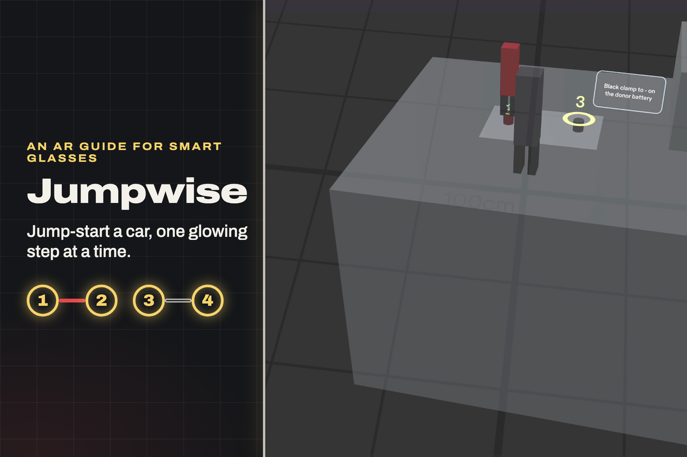
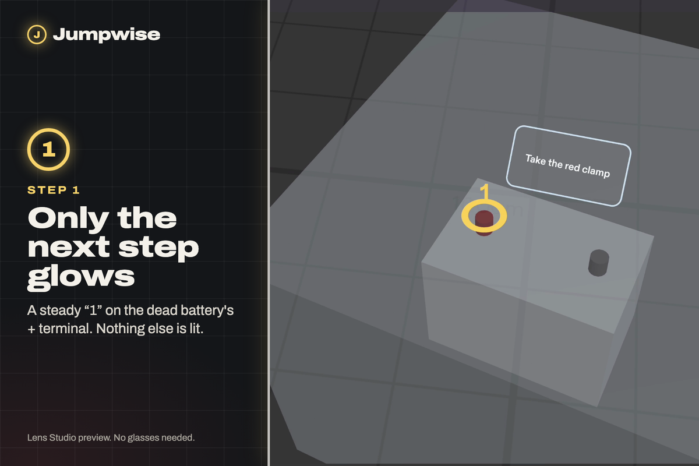
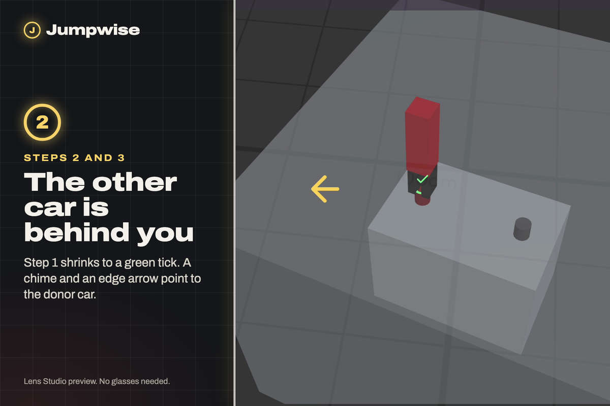
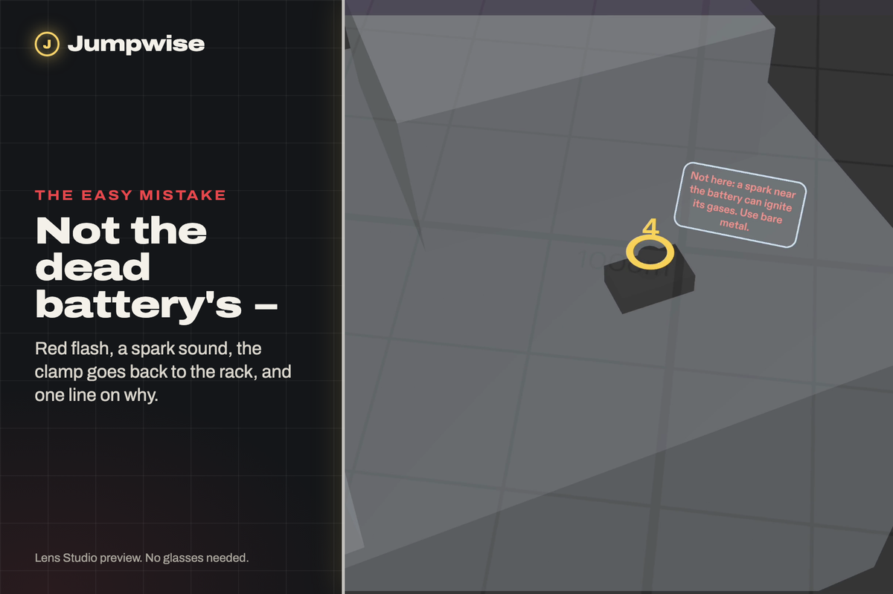
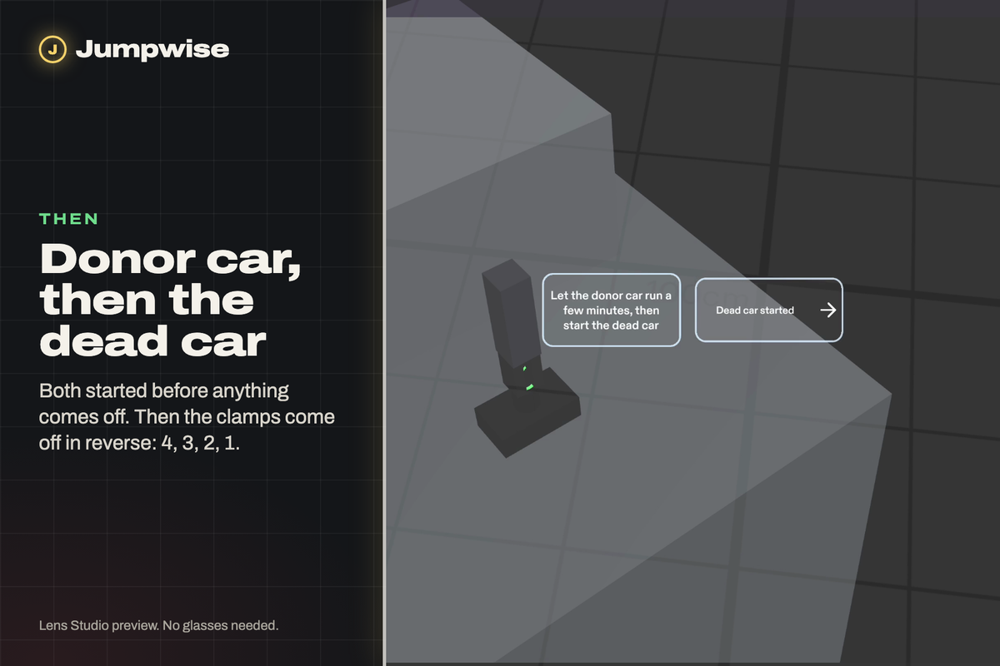
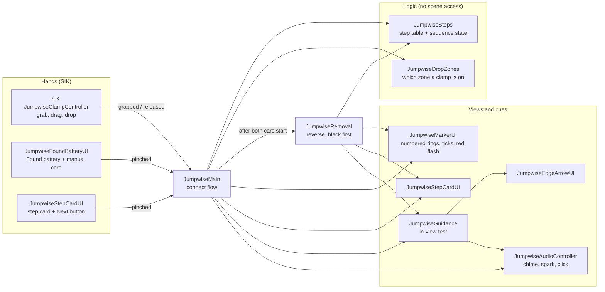
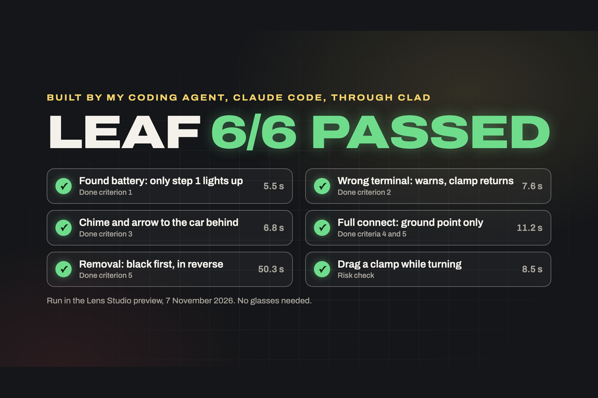

# Jumpwise

An AR guide for smart glasses that walks you through jump-starting a car: a glowing number on each battery terminal, one step at a time, in the safe order.

[](https://youtu.be/QnuE2HBpJc4)

**[Watch the demo (2:10)](https://youtu.be/QnuE2HBpJc4)** · Built for Devpost's **Learn AR with SPECS** · Runs in the Lens Studio preview, no glasses needed

> Jumpwise is a guide, not a safety device. Always check your owner's manual: some cars have remote jump points.

---

## Why

A flat battery is one of the most common reasons drivers call for roadside help: more than 40% of one Australian insurer's roadside callouts in the past year were battery-related ([Budget Direct, 2025](https://www.budgetdirect.com.au/roadside-assistance-australia/guides/the-most-common-callouts-for-roadside-assistance.html)). The fix is jumper cables, but most people do it rarely, often with a stranger who stopped to help, and the order matters. The last clamp goes on bare metal, away from the battery, because an engine bay may hold flammable gases and a spark could start a fire ([Edmunds](https://www.edmunds.com/how-to/jump-start.html)).

It's a job for glasses: your hands are full of heavy clamps and your eyes need to stay on the terminals. A phone needs a hand and makes you look away.

**Who it's for:** a driver who has never done it, or a stranger who stopped to help.

## What it does

| | |
|---|---|
|  |  |
| **Only the next step glows.** A steady "1" ring on the dead battery's + terminal and a short card beside it. Grab the red clamp and the ring pulses as the only drop target. Finished steps shrink to a green tick. | **The other car is behind you.** Steps 2 and 3 are on the donor car, out of view on purpose. A chime and an edge arrow point the way, and again when step 4 sends you back. |
|  |  |
| **It catches the easy mistake.** The last black clamp on the dead battery's − terminal gets a red flash, a spark sound, the clamp goes back to the rack, and one line on why. | **Start both cars, then off in reverse.** "Start donor car", then "Dead car started", then "Remove clamps" lights them in reverse, black first (4, 3, 2, 1), then "Done". |

In the preview, a big **"Found battery"** button stands in for battery detection: real glasses would find the battery, here you confirm it with one pinch.

## The three questions

From the design brief's "judge it" checklist:

- **Does it use what I'm looking at?** The steps sit on the terminals themselves, at real size.
- **Does it put something in my space, where it belongs?** Each car's steps are on that car. The donor car stays behind you, and Jumpwise points to it.
- **Does it free my hands or let me keep my eyes up?** Grab, drag and drop the clamps. The only buttons are one big pinch target at a time.

## How it was built

1. **Planned with the Devpost skill pack.** The `plan-lens` interview, answered in my own words, produced [`devpost/design-brief.md`](devpost/design-brief.md): the one spatial moment, where everything lives, hands and input, when things show, and five done criteria that can each be checked in the preview.
2. **Built by my coding agent, Claude Code, through CLAD and the Lens Studio MCP.** CLAD's builder worked from the brief in two passes: connect first, then removal on the same step logic.
3. **Tested with LEAF.** One scenario per done criterion, plus a risk check. The agent runs them in the preview through the MCP.
4. **Judged and fixed with design notes.** I walked the scene in Interactive Preview and gave fixes as design notes:
   - light outline plates instead of UI Kit's dark grey (the display is additive, so black is invisible), with bigger text;
   - the chime plays only when the next target is on the other car;
   - a "start the dead car" step before removal, after checking the order against Edmunds.

   The agent applied each fix and re-ran every test.

## Architecture

The guide is plain TypeScript components on Spectacles Interaction Kit (SIK) and Spectacles UI Kit. The step logic is pure and has no scene access; the views only show what they're told.



A drop counts when the clamp's tip is within reach of a zone in 3D, **or** when the line from your eye through the tip passes close to it. The second rule is what makes mouse dragging work in the preview; on glasses, your hand puts the tip on the terminal. Each drop zone is twice its visible size, per the brief.

## Tests (LEAF)



| Scenario | Checks | Done criterion | Result (7 Nov 2026) |
|---|---|---|---|
| `jw-c1-found-battery` | Pinching "Found battery" lights only step 1; grabbing the red clamp makes the ring pulse | 1 | ✅ passed, 5.5 s |
| `jw-c2-wrong-terminal` | A wrong drop shows the warning and returns the clamp | 2 | ✅ passed, 7.6 s |
| `jw-c3-chime-arrow` | After step 1, a chime and an arrow point to the donor car until it's in view | 3 | ✅ passed, 6.8 s |
| `jw-c4-c5-full-connect` | The last clamp only takes the ground point; "Start donor car" appears only after four correct clamps | 4, 5 | ✅ passed, 11.2 s |
| `jw-c5-removal` | Removal goes black first, in reverse, each clamp back to the rack, then "Done" | 5 | ✅ passed, 50.3 s |
| `jw-risk-turn-drag` | A clamp stays held while you turn 170° to the other car | risk check | ✅ passed, 8.5 s |

The scenarios live in `Assets/Scripts/JumpwiseLeaf*.ts` and are registered in `JumpwiseLeafIndex.ts`.

**Run them:** open the LEAF plugin panel in Lens Studio and run any `jw-` scenario. Each scenario needs a fresh preview. Alternatively, set `scenarioId` on the `JumpwiseLeafRunner` object and start the preview: the result is printed as `[JumpwiseLeaf] RESULT <id> PASSED`.

**Test-only objects in the scene:** `JumpwiseLeafRunner` does nothing while `scenarioId` is empty. The view scenarios (`jw-view-start`, `jw-view-step1`, `jw-view-long-text`) only hold a pose for screenshots. `jw-demo-walkthrough` drives the whole flow at viewing speed, and recorded the demo video.

## What's proven, what isn't

- **Logic proven:** the tests and the preview show the step order, the wrong-clamp warning, the chime and arrow, and removal in reverse working as the brief describes.
- **Feel unproven:** only real glasses can tell whether the rings, cards and sounds read well in daylight, at arm's length, with real clamps in your hands. Battery detection is a stand-in, not built.

## Open it in Lens Studio

Requirements: [Lens Studio](https://ar.snap.com/download) 5.22 or later (built with 5.24.1 on macOS, Apple silicon) and [Git LFS](https://git-lfs.com/). The packages, sounds, icons and meshes are stored with LFS.

```bash
git lfs install
git clone https://github.com/youneedgreg/Jumpwise.git
```

1. In Lens Studio, open `Jumpwise/Jumpwise.esproj`.
2. In the Preview panel, switch to Interactive Preview:
   - **WASD** to move, **Q / E** to go down and up;
   - **right-drag** to look around;
   - **click** to pinch;
   - **drag** to carry a clamp.
3. Look down at the dead car's battery and pinch **Found battery**. The donor car is behind you.

## Repository layout

```text
Jumpwise.esproj          Lens Studio project
Assets/Scripts/          the guide (Jumpwise*.ts) and its LEAF tests (JumpwiseLeaf*.ts)
Assets/GeneratedSFX/     chime, spark and clamp-click sounds
Assets/Icons/            the four UI icons
Assets/Scene.scene       engine bays, clamp rack, markers, cards
Packages/                SIK, UI Kit, LEAF (Bitmoji 3D is a LEAF dependency)
devpost/design-brief.md  the plan from the Devpost skill pack
docs/images/             README images
```

## Credits and disclosures

- **No pre-existing code.** The project started from Lens Studio's SPECS Base Template after the submission period opened.
- **Packages:** Spectacles Interaction Kit, Spectacles UI Kit and LEAF, by Snap.
- **Icons:** Google Material Icons (Apache-2.0), picked by CLAD's icon selector.
- **Sounds:** synthesised locally by CLAD's sound tool, with no samples. The demo video's piano was made the same way with CLAD's music tool.
- **Sources:** Budget Direct's roadside callout figures (2025) and Edmunds' jump-start guide.
- The engine bays are plain boxes, with no car brand logos.

## License

[MIT](LICENSE) © Gregory Temwa Odete
